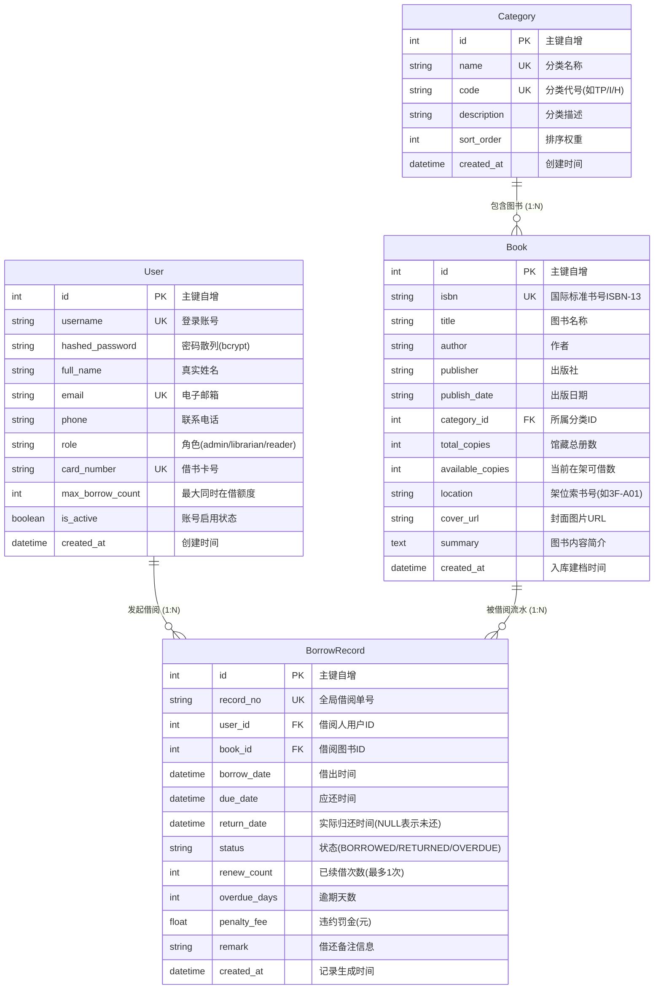

# 图书借阅管理系统 (LibraryHub) 数据库设计说明书

- **文档版本**：v1.0.0
- **编制日期**：2026-10-21
- **状态**：已评审 / 实施阶段
- **存储引擎**：SQLite 3 (开启 WAL 高性能并发模式与外键级联检查)

---

## 1. 概念模型与实体关系图 (E-R Diagram)

系统包含四个核心业务实体：**用户 (User)**、**分类 (Category)**、**图书 (Book)**、**借阅流转记录 (BorrowRecord)**。



---

## 2. 物理数据表详细设计

### 2.1 用户表 (`users`)
存储读者、图书管理员及系统管理员的身份与借书资质。

| 字段名 | 数据类型 | 允许空 | 默认值 | 约束说明 | 业务含义 |
| :--- | :--- | :--- | :--- | :--- | :--- |
| `id` | INTEGER | NO | 自增 | PRIMARY KEY | 用户唯一物理主键 |
| `username` | VARCHAR(50) | NO | 无 | UNIQUE, INDEX | 用户登录用户名 |
| `hashed_password` | VARCHAR(255) | NO | 无 | - | bcrypt 加密后的密码密文 |
| `full_name` | VARCHAR(64) | NO | `""` | - | 用户姓名 / 昵称 |
| `email` | VARCHAR(120) | NO | 无 | UNIQUE, INDEX | 电子邮箱，用于找回与通知 |
| `phone` | VARCHAR(20) | YES | NULL | - | 联系手机号码 |
| `role` | VARCHAR(20) | NO | `'reader'`| - | 用户角色：`admin` / `librarian` / `reader` |
| `card_number` | VARCHAR(32) | NO | 无 | UNIQUE, INDEX | 借书证号，全局唯一标识 |
| `max_borrow_count` | INTEGER | NO | `5` | CHECK > 0 | 最大同时在借图书数量上限 |
| `is_active` | BOOLEAN | NO | `1` | - | 账号状态：1-正常启用，0-冻结停用 |
| `created_at` | DATETIME | NO | CURRENT_TIMESTAMP | - | 注册创建时间 |
| `updated_at` | DATETIME | NO | CURRENT_TIMESTAMP | - | 最后资料更新时间 |

---

### 2.2 图书分类表 (`categories`)
存储馆藏图书类目，方便分级索引与分类统计。

| 字段名 | 数据类型 | 允许空 | 默认值 | 约束说明 | 业务含义 |
| :--- | :--- | :--- | :--- | :--- | :--- |
| `id` | INTEGER | NO | 自增 | PRIMARY KEY | 分类唯一主键 |
| `name` | VARCHAR(64) | NO | 无 | UNIQUE | 分类名称（如：计算机科学与技术） |
| `code` | VARCHAR(20) | NO | 无 | UNIQUE, INDEX | 中图分类法代号（如：TP312） |
| `description` | VARCHAR(255) | YES | NULL | - | 分类简介与适用专业领域说明 |
| `sort_order` | INTEGER | NO | `0` | - | 展示排序号，越小越靠前 |
| `created_at` | DATETIME | NO | CURRENT_TIMESTAMP | - | 分类创建时间 |

---

### 2.3 图书信息表 (`books`)
存储馆藏具体图书的核心元数据及在架物理库存状态。

| 字段名 | 数据类型 | 允许空 | 默认值 | 约束说明 | 业务含义 |
| :--- | :--- | :--- | :--- | :--- | :--- |
| `id` | INTEGER | NO | 自增 | PRIMARY KEY | 图书唯一编号 |
| `isbn` | VARCHAR(20) | NO | 无 | UNIQUE, INDEX | 国际标准书号（ISBN-10 或 ISBN-13） |
| `title` | VARCHAR(200) | NO | 无 | INDEX | 图书书名（支持模糊索引） |
| `author` | VARCHAR(100) | NO | 无 | INDEX | 作者 / 译者姓名 |
| `publisher` | VARCHAR(100) | YES | NULL | - | 出版社机构名称 |
| `publish_date` | VARCHAR(20) | YES | NULL | - | 出版年份或日期（如：2024-05） |
| `category_id` | INTEGER | NO | 无 | FOREIGN KEY | 关联分类表 ID，外键索引 |
| `total_copies` | INTEGER | NO | `1` | CHECK $\ge 0$ | 馆藏总采购册数 |
| `available_copies`| INTEGER | NO | `1` | CHECK $\ge 0$ | 当前在架可供借出册数 |
| `location` | VARCHAR(50) | YES | `'1F-A01'` | - | 馆藏物理架位（楼层-架区-层排） |
| `cover_url` | VARCHAR(500) | YES | NULL | - | 图书封面图片链接 |
| `summary` | TEXT | YES | NULL | - | 图书导读与内容简介 |
| `created_at` | DATETIME | NO | CURRENT_TIMESTAMP | - | 编目入库时间 |
| `updated_at` | DATETIME | NO | CURRENT_TIMESTAMP | - | 资料变更时间 |

---

### 2.4 借阅流转记录表 (`borrow_records`)
跟踪记录从借出到归还的全生命周期状态、逾期核算与违约罚金。

| 字段名 | 数据类型 | 允许空 | 默认值 | 约束说明 | 业务含义 |
| :--- | :--- | :--- | :--- | :--- | :--- |
| `id` | INTEGER | NO | 自增 | PRIMARY KEY | 流水主键 ID |
| `record_no` | VARCHAR(40) | NO | 无 | UNIQUE, INDEX | 借阅单号（如：`BR-20261021-98762`） |
| `user_id` | INTEGER | NO | 无 | FOREIGN KEY | 借阅人用户 ID，建立外键索引 |
| `book_id` | INTEGER | NO | 无 | FOREIGN KEY | 借出图书物理 ID，建立外键索引 |
| `borrow_date` | DATETIME | NO | CURRENT_TIMESTAMP | - | 实际借出起始时间 |
| `due_date` | DATETIME | NO | 无 | INDEX | 约定应还时间（默认借出时间+30天） |
| `return_date` | DATETIME | YES | NULL | - | 实际归还完成时间（未归还时为空） |
| `status` | VARCHAR(20) | NO | `'BORROWED'` | INDEX | 流转状态：`BORROWED`/`RETURNED`/`OVERDUE` |
| `renew_count` | INTEGER | NO | `0` | - | 已续借次数（系统限制最大1次） |
| `overdue_days` | INTEGER | NO | `0` | - | 逾期超期天数 |
| `penalty_fee` | DECIMAL(8,2)| NO | `0.00` | - | 逾期罚金金额（单位：元） |
| `remark` | VARCHAR(255) | YES | NULL | - | 经办备注或损益说明 |
| `created_at` | DATETIME | NO | CURRENT_TIMESTAMP | - | 单据创建时间 |

---

## 3. 完整 DDL 建表 SQL 脚本

```sql
-- 开启外键约束支持
PRAGMA foreign_keys = ON;

-- 1. 用户表
CREATE TABLE IF NOT EXISTS users (
    id INTEGER PRIMARY KEY AUTOINCREMENT,
    username VARCHAR(50) NOT NULL UNIQUE,
    hashed_password VARCHAR(255) NOT NULL,
    full_name VARCHAR(64) NOT NULL DEFAULT '',
    email VARCHAR(120) NOT NULL UNIQUE,
    phone VARCHAR(20),
    role VARCHAR(20) NOT NULL DEFAULT 'reader',
    card_number VARCHAR(32) NOT NULL UNIQUE,
    max_borrow_count INTEGER NOT NULL DEFAULT 5,
    is_active BOOLEAN NOT NULL DEFAULT 1,
    created_at DATETIME NOT NULL DEFAULT CURRENT_TIMESTAMP,
    updated_at DATETIME NOT NULL DEFAULT CURRENT_TIMESTAMP
);
CREATE INDEX IF NOT EXISTS idx_users_username ON users(username);
CREATE INDEX IF NOT EXISTS idx_users_email ON users(email);
CREATE INDEX IF NOT EXISTS idx_users_card_number ON users(card_number);

-- 2. 图书分类表
CREATE TABLE IF NOT EXISTS categories (
    id INTEGER PRIMARY KEY AUTOINCREMENT,
    name VARCHAR(64) NOT NULL UNIQUE,
    code VARCHAR(20) NOT NULL UNIQUE,
    description VARCHAR(255),
    sort_order INTEGER NOT NULL DEFAULT 0,
    created_at DATETIME NOT NULL DEFAULT CURRENT_TIMESTAMP
);
CREATE INDEX IF NOT EXISTS idx_categories_code ON categories(code);

-- 3. 图书信息表
CREATE TABLE IF NOT EXISTS books (
    id INTEGER PRIMARY KEY AUTOINCREMENT,
    isbn VARCHAR(20) NOT NULL UNIQUE,
    title VARCHAR(200) NOT NULL,
    author VARCHAR(100) NOT NULL,
    publisher VARCHAR(100),
    publish_date VARCHAR(20),
    category_id INTEGER NOT NULL,
    total_copies INTEGER NOT NULL DEFAULT 1,
    available_copies INTEGER NOT NULL DEFAULT 1,
    location VARCHAR(50) DEFAULT '1F-A01',
    cover_url VARCHAR(500),
    summary TEXT,
    created_at DATETIME NOT NULL DEFAULT CURRENT_TIMESTAMP,
    updated_at DATETIME NOT NULL DEFAULT CURRENT_TIMESTAMP,
    FOREIGN KEY (category_id) REFERENCES categories(id) ON DELETE RESTRICT
);
CREATE INDEX IF NOT EXISTS idx_books_isbn ON books(isbn);
CREATE INDEX IF NOT EXISTS idx_books_title ON books(title);
CREATE INDEX IF NOT EXISTS idx_books_author ON books(author);
CREATE INDEX IF NOT EXISTS idx_books_category ON books(category_id);

-- 4. 借阅流转记录表
CREATE TABLE IF NOT EXISTS borrow_records (
    id INTEGER PRIMARY KEY AUTOINCREMENT,
    record_no VARCHAR(40) NOT NULL UNIQUE,
    user_id INTEGER NOT NULL,
    book_id INTEGER NOT NULL,
    borrow_date DATETIME NOT NULL DEFAULT CURRENT_TIMESTAMP,
    due_date DATETIME NOT NULL,
    return_date DATETIME,
    status VARCHAR(20) NOT NULL DEFAULT 'BORROWED',
    renew_count INTEGER NOT NULL DEFAULT 0,
    overdue_days INTEGER NOT NULL DEFAULT 0,
    penalty_fee DECIMAL(8,2) NOT NULL DEFAULT 0.00,
    remark VARCHAR(255),
    created_at DATETIME NOT NULL DEFAULT CURRENT_TIMESTAMP,
    FOREIGN KEY (user_id) REFERENCES users(id) ON DELETE CASCADE,
    FOREIGN KEY (book_id) REFERENCES books(id) ON DELETE RESTRICT
);
CREATE INDEX IF NOT EXISTS idx_borrows_user ON borrow_records(user_id);
CREATE INDEX IF NOT EXISTS idx_borrows_book ON borrow_records(book_id);
CREATE INDEX IF NOT EXISTS idx_borrows_status ON borrow_records(status);
CREATE INDEX IF NOT EXISTS idx_borrows_due_date ON borrow_records(due_date);
```

---

## 4. 数据库事务与并发一致性控制机制

在借阅和还书核心场景中，严格执行事务完整性：
- **借书事务 (Borrow Transaction)**：
  1. `SELECT * FROM books WHERE id = ?;` 并检查 `available_copies > 0`；
  2. `SELECT COUNT(*) FROM borrow_records WHERE user_id = ? AND status IN ('BORROWED', 'OVERDUE');` 检查在借额度；
  3. `SELECT COUNT(*) FROM borrow_records WHERE user_id = ? AND status = 'OVERDUE';` 确保无违规逾期；
  4. `UPDATE books SET available_copies = available_copies - 1 WHERE id = ? AND available_copies > 0;`（利用条件更新实现乐观并发校验）；
  5. `INSERT INTO borrow_records (...) VALUES (...);`；
  6. 提交事务，若任何一步抛错，全部回滚。
- **还书事务 (Return Transaction)**：
  1. 校验借阅单状态必须为 `BORROWED` 或 `OVERDUE`；
  2. 记录 `return_date`，根据当前时间与 `due_date` 差值计算 `overdue_days` 与 `penalty_fee`；
  3. 更新借阅单状态为 `RETURNED`；
  4. `UPDATE books SET available_copies = available_copies + 1 WHERE id = ?;`
  5. 提交事务。
