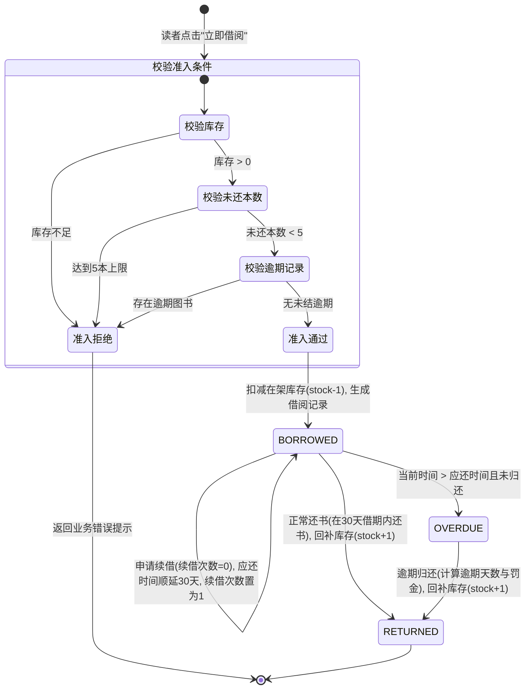

# LibraryHub 智能图书借阅管理系统 - 功能规格说明书 (Spec)

> **系统名称**：LibraryHub 智能图书借阅管理系统  
> **文档类型**：系统功能规格说明书 (Functional Specification)  
> **编制人**：[您的姓名] | 学号：[您的学号] （一人全栈独立实施）  
> **文档版本**：v1.0.0  
> **编制日期**：2026-10-21  
> **评审状态**：评审通过 / 实施交付完成  

---

## 1. 系统概述与业务目标

### 1.1 系统定位
LibraryHub 是一套基于现代化前后端分离架构、面向中小学校园图书室、企事业单位阅览室及社区书屋的智能图书借阅管理系统。系统旨在以极低的软硬件运维成本（低至 2 核 1G 内存服务器），提供高可靠的图书采编、多维度智能检索、库存原子并发控制、借还续借状态机流转闭环、读者行为风控以及运营数据大屏可视化能力。

### 1.2 核心业务目标
1. **自动化借还流转**：彻底告别纸质与手工 Excel 记账，读者在线发起借阅，还书系统一键核销回补库存。
2. **库存原子一致性**：杜绝图书“超卖”（库存扣至负数）或借出未扣减库存现象，确保线上数据与物理书架完全同步。
3. **借阅合规风控**：设定最大限借本数（默认 5 本）、单次借阅周期（30 天）、单次续借（顺延 30 天）与逾期阻断熔断机制。
4. **决策数据透明化**：通过轻量级统计图表直观展示馆藏结构与借还趋势，为后续图书采选提供真实可靠的数据支撑。

---

## 2. 用户角色与 RBAC 权限矩阵

系统严格基于 RBAC（基于角色的访问控制）模型实现，划分三种角色：

| 功能权限项 | 读者 (Reader) | 图书管理员 (Librarian) | 系统总管理员 (Admin) |
| :--- | :---: | :---: | :---: |
| 用户自主注册与登录 | :white_check_mark: | :white_check_mark: | :white_check_mark: |
| 个人信息维护 / 密码修改 | :white_check_mark: | :white_check_mark: | :white_check_mark: |
| 书目检索与分类浏览 | :white_check_mark: | :white_check_mark: | :white_check_mark: |
| 在线发起借阅申请 | :white_check_mark: | :white_check_mark: | :white_check_mark: |
| 在线图书续借申请 | :white_check_mark: | :white_check_mark: | :white_check_mark: |
| 个人借阅历史与在借查询 | :white_check_mark: | :white_check_mark: | :white_check_mark: |
| 自主还书操作 | :white_check_mark: | :white_check_mark: | :white_check_mark: |
| 图书采编入库与信息编辑 | :x: | :white_check_mark: | :white_check_mark: |
| 图书分类目录维护 | :x: | :white_check_mark: | :white_check_mark: |
| 图书安全下架与报废注销 | :x: | :white_check_mark: | :white_check_mark: |
| 全馆读者借阅流水统一监管 | :x: | :white_check_mark: | :white_check_mark: |
| 逾期记录标记与人工催还 | :x: | :white_check_mark: | :white_check_mark: |
| 用户账号检索与详情查看 | :x: | :x: | :white_check_mark: |
| 用户角色授权与停用/解冻 | :x: | :x: | :white_check_mark: |
| 全馆运营数据分析大屏查看 | :x: | :white_check_mark: | :white_check_mark: |

---

## 3. 核心借还业务流与状态机规范 (State Machine)

### 3.1 借还状态流转图
借阅流水单据定义了三种核心状态：
- `BORROWED` (借阅中)
- `RETURNED` (已归还)
- `OVERDUE` (已逾期)



### 3.2 业务风控规约 (Business Rules)
1. **最大同时借阅量**：单读者最多同时借出 `5` 本图书。若读者名下未归还图书数量 $\ge 5$，系统拒绝借阅。
2. **基准借阅时长**：单次借阅周期统一为 `30` 天，应还日期精确到秒计算：`due_date = borrow_date + 30 days`。
3. **续借控制机制**：
   - 每笔借阅单据仅允许续借 `1` 次；
   - 处于逾期状态的单据禁止续借，必须先归还；
   - 续借成功后，新的应还日期在原应还日期基础上增加 `30` 天：`due_date = old_due_date + 30 days`，并将单据标记为 `is_renewed = True`。
4. **逾期熔断机制**：若读者名下存在任何一笔处于 `OVERDUE`（已逾期且未归还）的记录，系统自动熔断其借阅权限，必须清偿逾期图书后方可恢复借阅。
5. **并发防超卖原子事务**：后端在处理借阅请求时，必须在同一事务内执行条件更新：
   ```sql
   UPDATE books SET available_copies = available_copies - 1 
   WHERE id = :book_id AND available_copies > 0;
   ```
   若影响行数为 0，立即回滚并抛出“库存不足”异常，防止高并发下超借。

---

## 4. 各功能模块详细用例规格

### 4.1 认证与个人中心模块 (Auth Module)
- **UC-01 用户注册**：
  - 输入项：用户名（3-30位，字母数字下划线）、登录密码（6-50位）、电子邮箱（合法格式）、真实姓名。
  - 逻辑：系统自动生成卡号格式 `CARD-YYYYMMDD-XXXX`，默认角色分配为 `reader`，密码经 bcrypt 单向加密哈希入库。
- **UC-02 用户登录**：
  - 输入项：用户名、密码。
  - 逻辑：校验用户名存在性与密码哈希匹配性；若账号处于禁用状态，阻断登录；校验通过签发有效时长为 7 天的 JWT Bearer Token。
- **UC-03 个人信息与安全中心**：
  - 读者可在线查看个人借书卡号、绑定邮箱、当前借阅额度（已借/上限）；支持旧密码验证后更换新密码。

### 4.2 图书分类管理模块 (Category Module)
- **UC-04 分类列表与检索**：
  - 分页返回全部分类，字段包含：分类名称、分类编码（唯一字母数字）、分类描述、图书归属统计计数。
- **UC-05 新增/编辑分类**（管理员权限）：
  - 校验分类编码与名称的全局唯一性，支持修改分类描述。
- **UC-06 分类删除**（管理员权限）：
  - 物理删除前置校验：若该分类下关联有任何在库图书，系统拒绝删除并提示“该分类下存在图书，请先调整图书分类”。

### 4.3 图书采编与多维检索模块 (Book Module)
- **UC-07 图书列表与组合检索**：
  - 支持多维度组合筛选：分类筛选、关键词匹配（书名 / 作者 / 出版社 / ISBN）、是否仅看有库存。
  - 支持分页（默认 10 条/页）与多种排序规则（最新上架、借阅量排序）。
- **UC-08 图书采编入库**（管理员权限）：
  - 录入字段：ISBN-13（必填且唯一）、正副书名、作者、出版社、分类 ID、出版年份、架位号（如 `2F-B-03`）、总藏书量、内容简介。
  - 系统自动初始化 `available_copies = total_copies`。
- **UC-09 图书信息维护与增补**（管理员权限）：
  - 支持修改图书元数据；当图书馆采购追加复本时，支持直接调增总册数与可借册数。
- **UC-10 图书下架注销**（管理员权限）：
  - 核心防呆校验：检查该图书在借记录。若 `available_copies < total_copies`，系统强制拦截，禁止下架。

### 4.4 借还与流水追踪模块 (Borrow Module)
- **UC-11 在线一键借阅**：
  - 读者在书目列表中点击“借阅”，前端提交 `POST /api/v1/borrows`。
  - 后端执行原子借阅事务：准入核验 -> 扣减库存 -> 新增借阅单（状态 `BORROWED`）。
- **UC-12 在线自主还书 / 线下核验还书**：
  - 提交 `POST /api/v1/borrows/{record_id}/return`。
  - 后端更新借阅单状态为 `RETURNED`，记录实际归还时间 `return_date`；原子回补图书库存 `available_copies + 1`；计算实际是否逾期及超期天数。
- **UC-13 在线续借延期**：
  - 提交 `POST /api/v1/borrows/{record_id}/renew`。
  - 校验续借次数与逾期状态，更新 `due_date` 与 `renew_count`。
- **UC-14 我的借阅与全馆借还流水**：
  - 读者端仅呈现当前登录用户的借阅流水（包含借出时间、应还时间、当前状态、续借按钮、还书按钮）。
  - 管理员端呈现全馆所有借阅流水，支持按读者姓名、借书卡号、图书名称、单据状态联合搜索。

### 4.5 数据大屏与统计分析模块 (Dashboard Module)
- **UC-15 运营总览指标统计**：
  - 实时聚合 4 项核心经营指标：全馆藏书种数、馆藏总册数、当前在借总册数、注册读者总人数。
- **UC-16 趋势与分布可视化**：
  - **借还趋势图**：统计近 7 天每日的“借出量”与“还书量”折线走势。
  - **图书分类占比**：呈现计算机、文学、自然科学、经济管理等各类图书所占百分比。
  - **借阅热榜 Top 10**：按借阅频次降序统计借阅率最高的图书清单。

### 4.6 用户权限与账号管理模块 (User Module - 管理员)
- **UC-17 读者与管理员账号维护**：
  - 分页浏览用户列表，呈现字段：用户名、姓名、邮箱、借书卡号、当前角色、账号状态、注册时间。
  - 管理员可进行角色提权（分配为管理员）或降权操作。
  - 管理员可一键冻结违规账号（设置 `is_active = False`），冻结后该用户无法登录。

---

## 5. 异常处理与统一响应规格

系统遵循 RESTful 规范，所有 HTTP 响应均采用标准结构化 JSON 格式交付：

### 5.1 成功响应格式
```json
{
  "code": 200,
  "message": "操作成功",
  "data": { ... }
}
```

### 5.2 业务异常响应规范
| 异常场景 | HTTP 状态码 | 返回 code | 业务提示信息 (message) |
| :--- | :---: | :---: | :--- |
| 用户名或密码错误 | 400 | 400 | "用户名或密码不正确" |
| 账号已被冻结 | 403 | 403 | "该账号已被管理员禁用，请联系图书馆管理员" |
| 未登录或 Token 失效 | 401 | 401 | "未提供身份凭证或登录已过期，请重新登录" |
| 越权操作（读者访问管理员接口） | 403 | 403 | "无权访问此资源，需要管理员权限" |
| 图书可借库存不足 | 400 | 400 | "该图书当前在架库存不足，无法借阅" |
| 借阅达到上限 | 400 | 400 | "您当前在借图书已达 5 本上限，请归还后再借" |
| 存在逾期未还图书 | 400 | 400 | "您存在已超期未还的图书，借阅权限已暂停" |
| 该图书已经续借过 | 400 | 400 | "该图书已办理过续借，无法二次续借" |
| 图书存在在借记录不可下架 | 400 | 400 | "该图书尚有读者借阅未还，禁止下架操作" |
