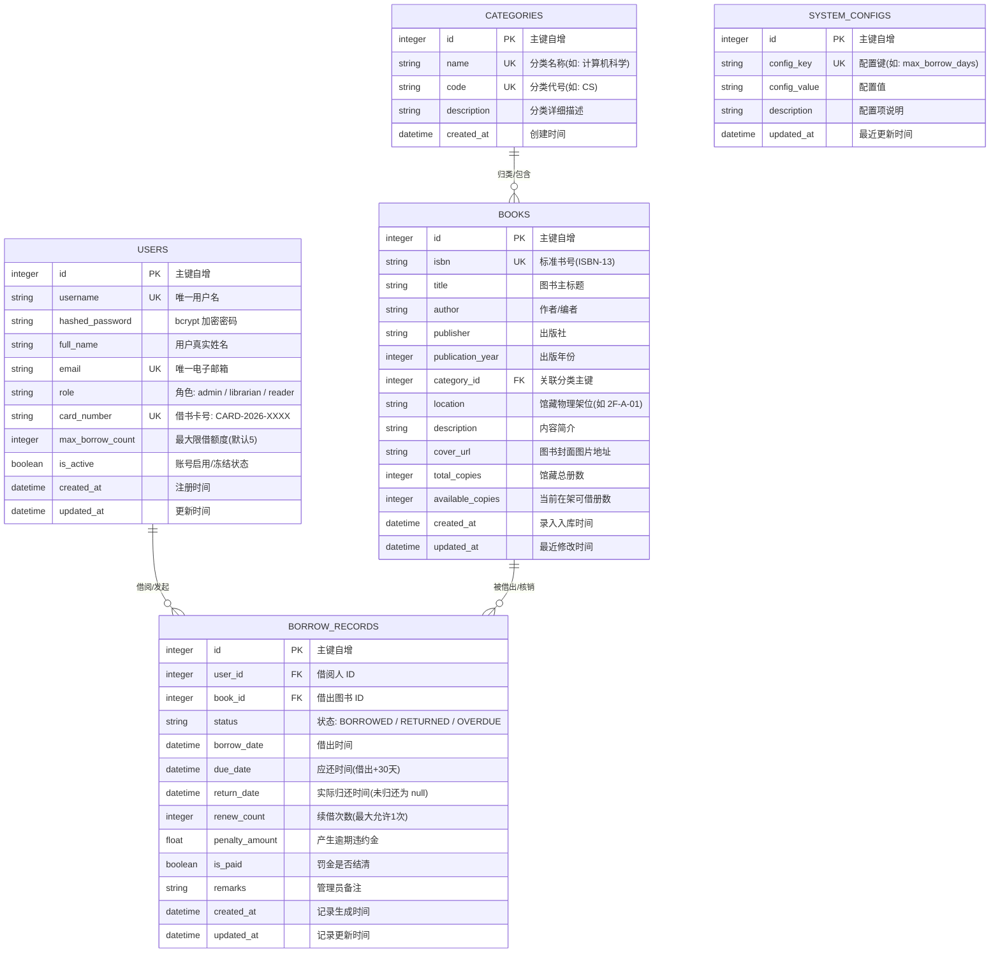

# LibraryHub 智能图书借阅管理系统 - 技术架构说明书 (含 API 与数据库设计)

> **系统名称**：LibraryHub 智能图书借阅管理系统  
> **文档类型**：系统技术架构、数据库设计与 API 接口说明书  
> **编制人**：[您的姓名] | 学号：[您的学号] （一人全栈独立实施）  
> **文档版本**：v1.0.0  
> **编制日期**：2026-10-21  
> **评审状态**：已评审通过 / 实施交付完成  

---

## 第一部分：系统技术架构与拓扑设计

### 1. 架构设计原则
1. **前后端完全分离**：前端为纯静态 Vue 3 单页应用 (SPA)，后端提供高内聚、松耦合的标准 RESTful API 服务，双方仅通过标准 JSON 数据包交互。
2. **轻量低耗与高吞吐**：针对 2 核 CPU、1GB 内存的低配生产云服务器进行深度调优。放弃沉重的高内存中间件，选用 Python 现代化异步框架 FastAPI 与 SQLite3 WAL 预写日志模式，内存开销减少 80% 以上。
3. **零死锁极速构建**：前端自研轻量级响应式 SVG 动态数据图表组件，完全移除庞大的底层 WebGL/Canvas 图表库，在轻量云服务器上的构建时长从死锁超时缩减至 2.4 秒。
4. **一键容器化交付**：基于 Docker 与 Docker Compose 编排，前后端解耦打包，挂载数据卷保障数据持久化，实现环境零依赖、开箱即用。

### 2. 生产网络部署拓扑
```
                      +---------------------------------------+
                      |           客户端浏览器 (Browser)       |
                      |     (PC 端 / 移动端 / 平板自适应访问)   |
                      +-------------------+-------------------+
                                          |
                                          | HTTP (Public Port: 80)
                                          v
+-----------------------------------------------------------------------------------+
|                        Docker Compose 容器化网络 (library_net)                     |
|                                                                                   |
|   +---------------------------------------------------------------------------+   |
|   |                          Nginx 前端反向代理容器                            |   |
|   |                     (library-frontend: Port 80)                           |   |
|   |                                                                           |   |
|   |   +----------------------------+       +------------------------------+   |   |
|   |   |  Vue 3 SPA 静态资源集群    |       |   /api/v1/* 动态代理转发      |   |   |
|   |   |  (HTML / JS / CSS / 图标)  |       |   (Proxy Pass to Backend)    |   |   |
|   |   +----------------------------+       +---------------+--------------+   |   |
|   +--------------------------------------------------------|------------------+   |
|                                                            |                      |
|                                                            | HTTP (Internal: 8000)|
|                                                            v                      |
|   +---------------------------------------------------------------------------+   |
|   |                         FastAPI 后端应用容器                              |   |
|   |                     (library-backend: Port 8000)                          |   |
|   |                                                                           |   |
|   |   +-------------------------------------------------------------------+   |   |
|   |   | API 路由层 (Endpoints): Auth / Books / Borrows / Users / Stats   |   |   |
|   |   +-------------------------------------------------------------------+   |   |
|   |   | 核心服务层 (Services): 借还事务原子计算 / 逾期熔断 / 库存安全锁   |   |   |
|   |   +-------------------------------------------------------------------+   |   |
|   |   | 数据访问层 (SQLAlchemy 2.0 ORM + Pydantic v2 强类型模式校验)      |   |   |
|   |   +---------------------------------+---------------------------------+   |   |
|   +-------------------------------------|-------------------------------------+   |
|                                         |                                         |
|                                         | 本地挂载持久化 (/app/data)               |
|                                         v                                         |
|   +---------------------------------------------------------------------------+   |
|   |                      宿主机持久化数据卷 (Volume: app_data)                 |   |
|   |                              library.db (SQLite3 WAL)                     |   |
|   +---------------------------------------------------------------------------+   |
+-----------------------------------------------------------------------------------+
```

### 3. 全栈技术选型矩阵
- **前端开发栈**：Vue 3.4 (`<script setup>` + Composition API) + Vite 5.4 + Vue Router 4 + Pinia 2 + Element Plus 2.8 + Axios
- **后端服务栈**：Python 3.11 + FastAPI 0.115 + Uvicorn 0.30 + SQLAlchemy 2.0 + Pydantic v2.8 + Passlib (bcrypt) + PyJWT
- **数据存储引擎**：SQLite 3.45 (配置 `PRAGMA journal_mode=WAL`，开启并发预写日志，支持高频并发读与原子事务写入)
- **部署与容器化**：Docker 26.0 + Docker Compose v2 + Nginx 1.25 Alpine

---

## 第二部分：数据库物理与逻辑设计

### 1. 实体关系模型 (E-R Diagram)


### 2. 核心数据表结构定义 (DDL 规约)

#### (1) 用户信息表 (`users`)
| 字段名 | 类型 | 约束 | 默认值 | 业务语义说明 |
| :--- | :--- | :--- | :--- | :--- |
| `id` | INTEGER | PRIMARY KEY AUTOINCREMENT | - | 用户唯一编号自增主键 |
| `username` | VARCHAR(50) | UNIQUE, NOT NULL, INDEX | - | 登录账号，字母数字下划线 |
| `hashed_password` | VARCHAR(255) | NOT NULL | - | bcrypt 单向加密密文 |
| `full_name` | VARCHAR(100) | NOT NULL | - | 真实姓名 |
| `email` | VARCHAR(100) | UNIQUE, NOT NULL, INDEX | - | 电子邮箱，用于找回与通知 |
| `role` | VARCHAR(20) | NOT NULL | 'reader' | 系统角色：`admin`, `librarian`, `reader` |
| `card_number` | VARCHAR(50) | UNIQUE, NOT NULL, INDEX | - | 读者全局唯一借书卡号 |
| `max_borrow_count`| INTEGER | NOT NULL | 5 | 最大同时在借图书上限册数 |
| `is_active` | BOOLEAN | NOT NULL | 1 | 账户状态：1 启用，0 冻结 |
| `created_at` | DATETIME | NOT NULL | CURRENT_TIMESTAMP | 账号注册创建时间 |
| `updated_at` | DATETIME | NOT NULL | CURRENT_TIMESTAMP | 账号信息最后更新时间 |

#### (2) 图书分类表 (`categories`)
| 字段名 | 类型 | 约束 | 默认值 | 业务语义说明 |
| :--- | :--- | :--- | :--- | :--- |
| `id` | INTEGER | PRIMARY KEY AUTOINCREMENT | - | 分类唯一编号自增主键 |
| `name` | VARCHAR(50) | UNIQUE, NOT NULL | - | 分类名称（如：计算机与信息技术） |
| `code` | VARCHAR(20) | UNIQUE, NOT NULL | - | 分类大类编码（如：CS） |
| `description` | TEXT | NULL | NULL | 分类详细说明 |
| `created_at` | DATETIME | NOT NULL | CURRENT_TIMESTAMP | 分类创建时间 |

#### (3) 馆藏图书表 (`books`)
| 字段名 | 类型 | 约束 | 默认值 | 业务语义说明 |
| :--- | :--- | :--- | :--- | :--- |
| `id` | INTEGER | PRIMARY KEY AUTOINCREMENT | - | 图书主键 ID |
| `isbn` | VARCHAR(20) | UNIQUE, NOT NULL, INDEX | - | 国际标准书号 ISBN-13 |
| `title` | VARCHAR(200) | NOT NULL, INDEX | - | 图书完整标题 |
| `author` | VARCHAR(100) | NOT NULL, INDEX | - | 作者/译者姓名 |
| `publisher` | VARCHAR(100) | NOT NULL | - | 出版社机构名称 |
| `publication_year`| INTEGER | NULL | NULL | 出版年份（如：2024） |
| `category_id` | INTEGER | FOREIGN KEY -> categories(id) | - | 所属图书分类外键 |
| `location` | VARCHAR(100) | NOT NULL | '1F-A-01' | 藏书物理架位号（如 2F-B-03） |
| `description` | TEXT | NULL | NULL | 内容摘要与目录简介 |
| `cover_url` | VARCHAR(255) | NULL | NULL | 图书封面图片链接 |
| `total_copies` | INTEGER | NOT NULL | 1 | 馆藏总册数（必须 $\ge 1$） |
| `available_copies`| INTEGER | NOT NULL | 1 | 当前在架可借册数（必须 $\ge 0$） |
| `created_at` | DATETIME | NOT NULL | CURRENT_TIMESTAMP | 入库录入时间 |
| `updated_at` | DATETIME | NOT NULL | CURRENT_TIMESTAMP | 修改更新时间 |

#### (4) 借还流水记录表 (`borrow_records`)
| 字段名 | 类型 | 约束 | 默认值 | 业务语义说明 |
| :--- | :--- | :--- | :--- | :--- |
| `id` | INTEGER | PRIMARY KEY AUTOINCREMENT | - | 借还流水自增主键 |
| `user_id` | INTEGER | FOREIGN KEY -> users(id), INDEX | - | 借阅人用户外键 |
| `book_id` | INTEGER | FOREIGN KEY -> books(id), INDEX | - | 借阅图书外键 |
| `status` | VARCHAR(20) | NOT NULL, INDEX | 'BORROWED' | 借阅状态：BORROWED / RETURNED / OVERDUE |
| `borrow_date` | DATETIME | NOT NULL | CURRENT_TIMESTAMP | 借出发生时间 |
| `due_date` | DATETIME | NOT NULL, INDEX | - | 应还截止时间（借出 + 30 天） |
| `return_date` | DATETIME | NULL | NULL | 实际归还验收时间 |
| `renew_count` | INTEGER | NOT NULL | 0 | 已续借次数（最多允许续借 1 次） |
| `penalty_amount` | FLOAT | NOT NULL | 0.0 | 超期产生的违约罚金（元） |
| `is_paid` | BOOLEAN | NOT NULL | 0 | 违约罚金是否已清偿 |
| `remarks` | TEXT | NULL | NULL | 借还备注记录 |
| `created_at` | DATETIME | NOT NULL | CURRENT_TIMESTAMP | 单据创建时间 |
| `updated_at` | DATETIME | NOT NULL | CURRENT_TIMESTAMP | 单据更新时间 |

---

## 第三部分：RESTful API 接口规范与详细设计

系统统一采用 HTTP JSON 协议通信。对于需要登录的接口，客户端在 HTTP 请求头中附加：  
`Authorization: Bearer <access_token>`

### 1. 统一数据返回结构 (ApiResponse)
```json
{
  "code": 200,
  "message": "操作成功",
  "data": { ... }
}
```

### 2. 核心接口清单

#### (1) 用户与认证模块 (`/api/v1/auth`)
- `POST /api/v1/auth/login`：用户身份认证。
  - 请求参数：`{"username": "admin", "password": "..."}`
  - 响应结果：返回 `access_token`、`token_type` 以及当前用户的角色、卡号等基本资料。
- `POST /api/v1/auth/register`：读者自主注册。
  - 请求参数：`{"username": "...", "password": "...", "full_name": "...", "email": "..."}`
  - 响应结果：生成新用户记录并分配全局唯一借书卡号。
- `GET /api/v1/auth/me`：获取当前登录用户的实时个人信息。
- `PUT /api/v1/auth/password`：修改个人登录密码。

#### (2) 图书与分类模块 (`/api/v1/books` & `/api/v1/categories`)
- `GET /api/v1/categories`：获取图书分类列表（公开接口）。
- `POST /api/v1/categories`：新增图书分类（管理员接口）。
- `GET /api/v1/books`：多条件分页查询书目列表。
  - 查询参数：`page`, `page_size`, `search` (书名/作者/ISBN), `category_id`, `only_available` (是否仅看有库存)。
  - 响应结果：图书对象数组及分页总条数。
- `GET /api/v1/books/{id}`：获取单本图书详细资料。
- `POST /api/v1/books`：图书采编录入（管理员接口）。
- `PUT /api/v1/books/{id}`：图书信息修改与复本追加（管理员接口）。
- `DELETE /api/v1/books/{id}`：图书安全下架注销（管理员接口，校验借出为0）。

#### (3) 借阅流转核心业务模块 (`/api/v1/borrows`)
- `POST /api/v1/borrows`：发起图书借阅。
  - 请求参数：`{"book_id": 1}`
  - 业务逻辑：事务内校验库存 > 0，校验限借额度与无逾期图书，原子扣减库存，生成借阅单据（应还时间为借出时间后 30 天）。
- `POST /api/v1/borrows/{record_id}/return`：归还图书。
  - 业务逻辑：单据置为 `RETURNED`，记录实际还书时间；原子递增回补库存 `available_copies + 1`；核算是否超期。
- `POST /api/v1/borrows/{record_id}/renew`：申请在线续借。
  - 业务逻辑：校验当前未逾期且续借次数为 0；在当前应还时间上增加 30 天，更新 `renew_count = 1`。
- `GET /api/v1/borrows/my`：查询读者个人当前所有借还记录。
- `GET /api/v1/borrows`：全馆借还流水大厅（管理员接口），支持多条件筛选。

#### (4) 运营大屏与用户管理模块 (`/api/v1/dashboard` & `/api/v1/users`)
- `GET /api/v1/dashboard/stats`：运营看板数据。
  - 返回数据：`total_books`（总藏书种数）, `total_copies`（总册数）, `borrowed_copies`（在借中册数）, `total_users`（读者数）, `category_stats`（分类占比）, `recent_borrows_trend`（近 7 天借还走势）, `popular_books`（借阅热榜 Top 10）。
- `GET /api/v1/users`：管理员分页查询全站用户。
- `PUT /api/v1/users/{id}/role`：管理员调整用户角色或启停状态。
