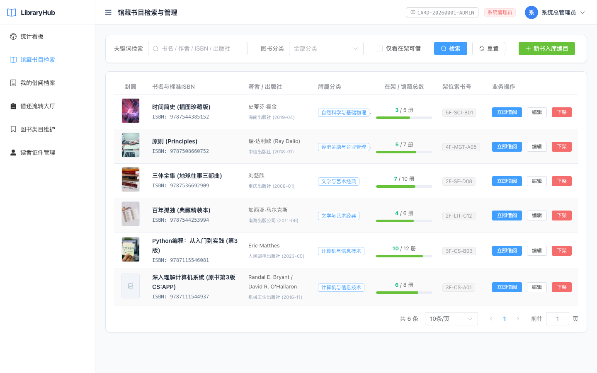
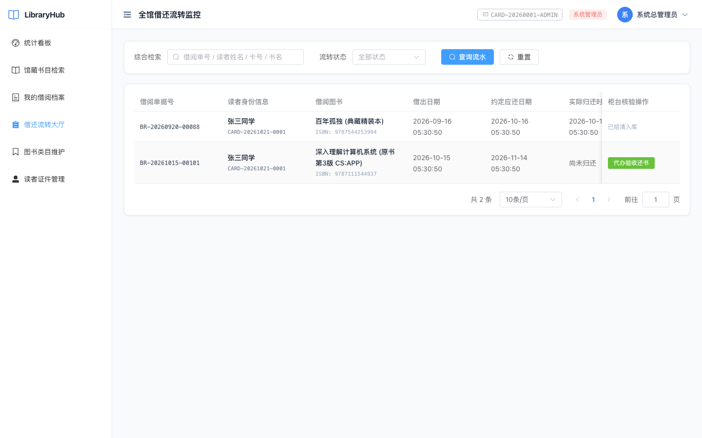

# LibraryHub 智能图书借阅管理系统 · 用户与管理员操作手册

| 手册属性 | 登记信息 |
| :--- | :--- |
| **系统名称** | **LibraryHub 智能图书借阅管理系统** |
| **申报单位** | 北京信息科技大学 · 计算机学院 |
| **班级学号** | 计科2302班 · 2023011210 |
| **编制人** | 句昭南（个人独立全栈研发，贡献率 100%） |
| **系统版本** | v1.0.0 (Release) |
| **公网体验入口** | [http://39.96.0.20/](http://39.96.0.20/) (公网直接访问) |
| **API 在线文档** | [http://39.96.0.20/docs](http://39.96.0.20/docs) (Swagger UI) |

---

  
**【手机扫码直达 LibraryHub 生产系统】**（公网地址：[http://39.96.0.20/](http://39.96.0.20/)）

---

## 一、 系统运行环境与访问方式

### 1.1 客户端访问环境
- **生产公网统一入口**：[http://39.96.0.20/](http://39.96.0.20/) (默认 HTTP 80 端口，开箱即用)
- **推荐浏览器**：Google Chrome (100+)、Microsoft Edge、Safari、Firefox 等现代浏览器。
- **设备适配**：PC 端宽屏（1080P/2K/4K）、笔记本自适应屏幕以及平板/手机移动端浏览器。

### 1.2 预置演示账户矩阵
系统已预先在生产环境初始化了覆盖三级角色的体验账户：

| 角色类别 | 登录账号 | 初始密码 | 对应借书卡号 | 主要测试权限 |
| :--- | :--- | :--- | :--- | :--- |
| **系统超级管理员** | `admin` | `admin123` | `CARD-20260001-ADMIN` | 全局最高权限、宏观数据看板大屏、书目采编管理、借还流转大厅、用户借书卡与限额治理 |
| **图书管理员** | `librarian` | `lib123` | `CARD-20260002-LIB` | 标准 ISBN 采编入库、库存动态维护、借还大厅监控、柜台代办核验还书 |
| **测试读者一** | `reader1` | `reader123` | `CARD-20260003-READ1` | 图书多维检索、在线一键借书、我的在借档案跟踪、在线一键续借、读者自主还书 |
| **测试读者二** | `reader2` | `reader123` | `CARD-20260004-READ2` | 用于多用户借阅与并发抢借防超卖测试 |

*(注：系统亦支持在登录页面点击“还没有账号？立即注册”自主创建全新的读者账号)*

---

## 二、 系统登录与身份认证

### 2.1 账号登录操作指引
1. 打开浏览器，输入公网访问地址：[http://39.96.0.20/](http://39.96.0.20/)；
2. 系统自动加载暗夜科技风登录卡片：
   - 输入对应账号（如 `admin` 或 `reader1`）；
   - 输入对应密码（如 `admin123` 或 `reader123`）；
   - 也可直接点击登录框下方的 **【快速填入测试账号】** 药丸按钮一键自动填充；
   - 点击 **【立即登录】** 按钮；
3. 登录验证通过后，系统自动缓存 JWT 访问令牌至本地，并根据用户角色自动分流跳转至对应功能工作台。


### 2.2 读者线上自主开卡注册
1. 在登录界面右侧选项卡点击 **【注册新账号】**；
2. 填写注册必填表单：
   - **用户名**：3~30 位英文字符或数字；
   - **真实姓名**：如“句同学”；
   - **电子邮箱**：如 `reader@bistu.edu.cn`；
   - **登录密码**：设置 6 位以上密码；
3. 点击 **【完成注册并登录】**，系统后台将根据时间戳与序列号自动派发标准条码借书卡号（`CARD-YYYY-XXXX`），并自动登录进入图书大厅。

---

## 三、 读者端全流程操作指引 (Reader Portal)

### 3.1 馆藏图书多维检索与在架筛选
1. 点击左侧主导航栏 **【图书列表】**（或 **【图书大厅】**）；
2. **多维条件模糊搜索**：
   - 在顶部搜索输入框中键入书名、作者或 ISBN（例如输入“Python”或“算法”）；
   - 在分类下拉选择框中选择目标学科（如“计算机科学”、“文学经典”）；
   - 点击勾选 **【仅显示在架有书】** 复选框，系统将自动过滤已借空的图书条目；
3. **查阅图书卡片信息**：
   - 列表以卡片形式直观展示：书名、著者、出版社、ISBN 编码、所属分类、物理架位号（如 `3F-CS-A01`）；
   - 重点关注 **【在架余量 / 馆藏总量】**（例如：`3 / 5 本` 表示全馆藏书 5 本，当前架上尚有 3 本可借）。



### 3.2 图书在线一键借阅
1. 在目标图书条目右侧，点击蓝色 **【借阅】** 按钮；
2. 系统弹出借阅确认弹窗，展示该图书当前在架余量、借期（30 天）及预期归还时间；
3. 点击 **【确认借阅】**：
   - 系统底层执行行级排他锁原子事务，在架可借数量即时扣减 1；
   - 成功借出后弹出绿色通知框，并可在“我的借阅”中实时查看；
   - 若图书在架数量为 0，系统将提示“该图书当前库存不足”并阻断借出；
   - 若读者在借本数已达 5 本限额，系统提示“借阅超限，请先归还已借图书”。

### 3.3 我的在借档案管理与在线续借
1. 点击左侧导航栏 **【我的借阅】**；
2. 页面清晰列出读者名下的所有流通记录，包括：
   - 图书名称与著者；
   - 借出时间、应还截止时间；
   - 状态标识：绿色 `借阅中`、灰色 `已归还`、红色 `已逾期`；
3. **办理一键延期续借**：
   - 在处于“借阅中”且未逾期的借阅卡片上，点击 **【申请续借】** 按钮；
   - 系统将在原应还日期基础上自动顺延 30 天，并将单据标记为“已续借（1/1）”；
   - 处于逾期状态的图书禁止续借；每本图书仅限续借一次。

### 3.4 读者自主线上还书
1. 读者在 **【我的借阅】** 列表中定位需要归还的书目；
2. 点击卡片右侧的 **【确认还书】** 按钮；
3. 系统核销单据状态为 `已归还`，自动登记归还时刻，图书在架可借册数立即自动回补 1 本。

---

## 四、 图书管理员端操作指引 (Librarian Portal)

### 4.1 国际标准 ISBN 智能编目入库
1. 使用馆员账号登录后，点击导航栏 **【图书管理】**；
2. 点击右上角 **【新增图书入库】** 按钮；
3. 在录入表单中填报采编字段：
   - **ISBN 编码**：标准 13 位国际标准书号（如 `978-7-111-54493-7`）；
   - **图书标题**：如《深入理解计算机系统》；
   - **著者姓名**：如 `Randal E. Bryant`；
   - **出版社**：如“机械工业出版社”；
   - **分类归属**：下拉选择对应的标准化分类（如“计算机科学”）；
   - **采购复本数**：录入入库总册数（如 `5` 本）；
   - **馆藏物理架位**：录入精准架位号（如 `3F-CS-B02`），便于物理巡架取书；
4. 点击 **【保存入库】**，书目即刻进入全馆可检索流转状态。

### 4.2 图书资产安全下架防呆保护
1. 在图书列表中点击需要下架注销的图书右侧 **【下架】** 按钮；
2. **在借下架保护机制**：  
   若该图书当前尚有任一复本处于读者借出未归还状态（即 `available_copies < total_copies`），系统将弹出**物理阻断提示**：“当前图书尚有在借复本未归还，禁止下架！请待全部归还后再执行下架注销。”有效杜绝了资产下架导致的流水死锁与图书遗失。

### 4.3 全馆借还流转工作台与柜台代办核验
1. 点击左侧导航栏 **【借还流转】**；
2. 工作台全景展现全馆所有读者的在借流水，支持按读者卡号、书名、逾期状态快速筛选；
3. **柜台人工验收归还**：
   - 读者将实体图书归还至服务台时，馆员查验书籍品相；
   - 馆员在对应记录行点击 **【代办还书】** 并录入核验备注（如“完好无缺”或“封面磨损”）；
   - 系统即刻回补在架库存并结清单据。



---

## 五、 系统管理员端操作指引 (Admin Portal)

### 5.1 运营决策可视化大屏监控 (Dashboard)
1. 登录管理员账号后，系统默认进入 **【运营大屏 (Dashboard)】**；
2. **四大核心指标卡片**：
   - **馆藏图书总种数**：全馆录入的书目种类规模；
   - **在架可借总册数**：全馆当前物理书架上可供借出的复本总和；
   - **当前流通在借本数**：读者已借出且尚未归还的书目总量；
   - **超期违约警示本数**：已超过应还时间且未还的异常违规件数（高亮红字警示）；
3. **近 7 天借还流转趋势折线图**：
   - 由自研纯原生响应式 SVG 引擎动态绘制，多维对比近一周的“借出走势”与“归还走势”；
   - 鼠标悬停在波形折点上可浮动查看具体某一天的借还精确实数；
4. **学科分类占比环形图与热门借阅榜 Top 10**：
   - 直观呈现各学科藏书比例；
   - 根据历史全量流水动态排名热门图书，为馆藏资源结构优化与补仓采购提供数据决策。


### 5.2 读者借书证与用户权限治理
1. 点击导航栏 **【用户管理】**；
2. 查看全量用户列表，包括用户名、真实姓名、电子邮箱、角色（Admin / Librarian / Reader）、借书卡号、最大借阅额度及账号状态；
3. **调整读者借阅权限与额度**：
   - 点击读者条目右侧 **【编辑】**，可调整其角色（例如将普通读者提升为图书管理员），或将其借阅额度从默认的 5 本提升至 10 本；
4. **违约与恶意用户一键封禁**：
   - 针对存在严重逾期、损坏图书或恶意攻击行为的用户，点击 **【停用账号】** 切换开关；
   - 账号封禁后，该用户尝试登录将直接被拦截，其借阅与续借接口均被物理阻断。


### 5.3 图书分类标准字典维护
1. 点击导航栏 **【分类管理】**；
2. 支持点击 **【新增分类】** 维护分类代号（如 `AI`）与分类全称（如“人工智能与机器人”）；
3. 分类具备**关联保护机制**：若某分类下已有关联图书资产，系统禁止直接删除该分类，防止数据孤岛。

---

## 六、 运维管理与容器化部署指南

### 6.1 服务启动与容器编排
项目采用标准 Docker Compose 编排，只需一行命令即可在生产主机上极速拉起：
```bash
# 进入工程根目录，一键后台构建并启动服务
docker compose up -d --build

# 检查容器运行状态与健康探针
docker compose ps
```
容器映射端口：
- `library-frontend`：宿主机 `80` 端口（Nginx 静态代理 + API 动态网关）；
- `library-backend`：内部网络 `8000` 端口（FastAPI Uvicorn 异步服务）。

### 6.2 数据库备份与持久化
数据库文件持久化保存在 Docker 卷 `/app/data/library.db`，开启 WAL 预写日志模式。数据热备只需执行：
```bash
# 安全热备 SQLite 数据库
sqlite3 /var/lib/docker/volumes/tesaicoding_app_data/_data/library.db ".backup '/backup/library_$(date +%Y%m%d).db'"
```

---

## 七、 常见问题解答与故障排查 (FAQ)

### Q1：为什么读者点击“借阅”提示“存在逾期图书，借阅权限已熔断”？
**原因分析**：这是 LibraryHub 的核心创新风控特性——**动态信用借阅熔断机制**。当读者名下有任何一本已超过 30 天应还日期尚未归还的图书时，系统在借阅入口处自动阻断新借权限。  
**解封方法**：读者进入“我的借阅”页面，将处于标红状态的逾期图书点击归还；归还清偿后，系统自动解冻借阅权限。

### Q2：为什么图书管理员无法下架某本图书？
**原因分析**：系统具备在借资产防呆保护机制。当图书的总藏书量大于在架可借数量（即 `available_copies < total_copies`）时，说明尚有物理图书流转在读者手中，此时系统严格禁止下架。  
**处理方式**：在借还流转大厅中催还该书，待所有读者将该书全部归还入库后，方可执行下架操作。

### Q3：为什么同一本书只能续借一次？
**原因分析**：为了保障馆藏公共资源的公平流通，避免热门书籍被单一读者长期垄断，系统业务规约严格设定单次借阅周期 30 天，且每笔单据最多允许续借 1 次（顺延 30 天，总计最长借期 60 天）。
